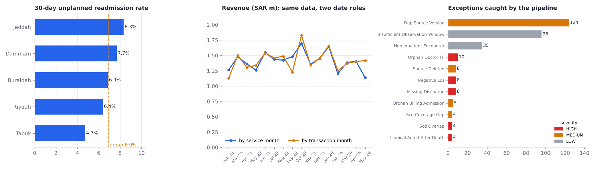
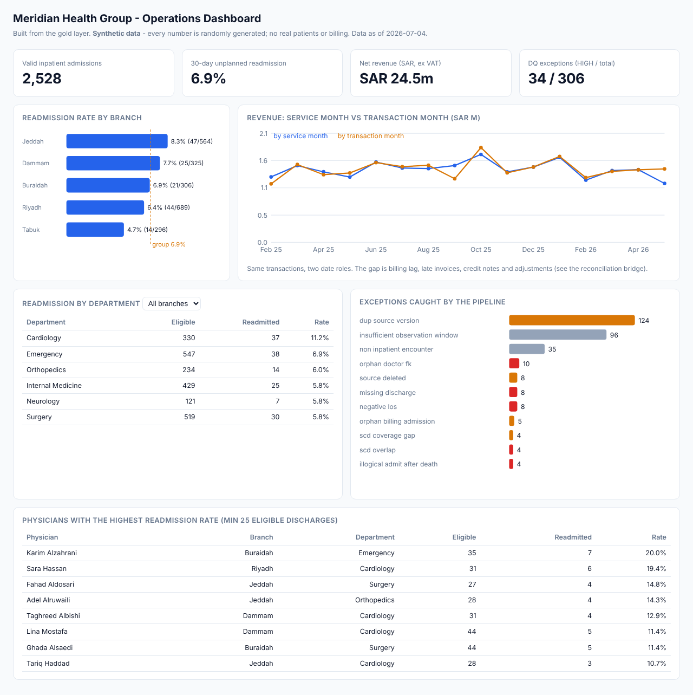
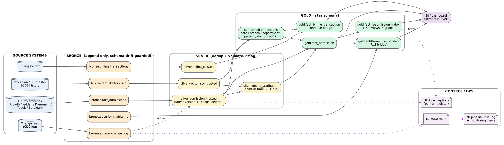

# Hospital Group Data Platform



A bronze / silver / gold analytics pipeline for a fictional five-branch hospital group (**Meridian Health Group**), built to be run, tested and read. It ingests five messy source extracts and produces a **trusted admission layer, a 30-day unplanned readmission KPI, a revenue reconciliation, and row-level security** - with the operational controls (schema-drift detection, CDC-style incremental loads, data-quality register, monitoring, replay) a pipeline needs to run unattended.

> **All data is synthetic.** `pipeline/generate_data.py` produces every record from a seed; there are no real patients, staff or invoices anywhere in this repo. The generator deliberately injects realistic defects (below) and records exactly what it planted, so the tests can prove the pipeline catches them.

**Stack:** Python 3.11+, DuckDB (SQL engine), pandas, pytest, GitHub Actions. SQL is portable to SQL Server / Snowflake (`sql/12_production_scale_reference.sql`).

## Quick start

```bash
pip install -r requirements.txt
python pipeline/run_pipeline.py              # full load  -> output/warehouse.duckdb + CSV marts
python -m pytest tests -q                    # 73 tests
python pipeline/demo_incremental.py          # CDC batches == full load; replay lands 0 rows
python pipeline/export_dq_register.py        # formatted Excel issue register
python pipeline/build_dashboard.py           # docs/dashboard.html (self-contained)
cd dbt && dbt build --profiles-dir .         # dbt port, incl. equivalence tests vs the SQL layer
python pipeline/generate_data.py --admissions 250000   # scale up (seeded, deterministic)
```
```sql
duckdb output/warehouse.duckdb
SELECT * FROM gold.vw_readmission_rate_by_branch;
SELECT count(*) FROM gold.secured_admission('riyadh.director@mhg.example');   -- row-level security
```

## Dashboard

[`docs/dashboard.html`](docs/dashboard.html) is a self-contained page (no server, no CDN) generated from the gold layer: KPI tiles, readmission by branch / department / physician, revenue by service vs transaction month, and the exceptions the pipeline caught.



## Architecture



| Layer | What happens |
|---|---|
| **Bronze** | Append-only landing of 5 sources (admissions, physician SCD2, billing, security matrix, change feed). Schema-drift check before every load. |
| **Silver** | Latest-version dedup, validity and quarantine flags, physician SCD2 point-in-time attribution. |
| **Gold** | Star schema (`fact_admission`, `fact_readmission_index`, `fact_billing_transaction`, conformed dimensions), KPI views at four grains, RLS bridge. |
| **Control** | `ctl.watermark`, `ctl.pipeline_run_log`, `ctl.dq_exceptions` (history kept per run), monitoring views and alerts. |

Target model: [`docs/erd.png`](docs/erd.png). Rules and trade-offs: [`docs/design_decisions.md`](docs/design_decisions.md). On-call guide: [`docs/runbook.md`](docs/runbook.md).

## Orchestration and dbt

- **dbt port** (`dbt/`): the silver and gold layers re-implemented as 13 dbt models with 32 tests (uniqueness, relationships, accepted values) plus four **equivalence tests that require the dbt output to equal the SQL pipeline's tables row for row**. `tests/test_dbt.py` runs it. The DQ register and monitoring views stay in SQL.
- **Airflow DAG** (`airflow/dags/meridian_pipeline.py`): hourly `land_bronze -> transform -> data_quality_gate -> dbt_build -> publish`, with retries, `max_active_runs=1`, and a gate that fails the run on any monitoring alert. It is validated structurally by `tests/test_dag.py` and its task logic is exercised by the suite, but it has **not** been run on a live Airflow deployment.

## What the pipeline has to survive

Each defect is injected at a configurable rate, and the test suite asserts the register catches *exactly* the planted keys per rule.

| Defect | Treatment |
|---|---|
| Duplicate source versions (incl. same-version tie-break) | Latest wins; history stays in bronze |
| Test and cancelled encounters | Excluded from valid admissions |
| Source-side deletes arriving via the change feed | Soft delete, effective only once the event arrives |
| Orphan physician keys | Synthetic Unknown member `DoctorSK = -1` |
| Negative / missing length of stay | Kept for counts, quarantined from readmission logic |
| Overlapping and gapped physician SCD2 windows | Latest correction / nearest prior assignment, flagged |
| Admission after a recorded death | Flagged for MRN reconciliation |
| Late-arriving corrections | Watermark on `AvailableToETL`, not modified time |
| Corrected invoices, credit notes, adjustments, late invoices, orphan invoices | Latest version, signed, bridged, flagged |
| Schema drift (added / removed / retyped columns) | Info / block that entity only |

## Results on the committed demo dataset (seed 42)

| | |
|---|---|
| Admission source rows -> distinct -> valid | 2,681 -> 2,571 -> 2,528 |
| 30-day unplanned readmission | 151 of 2,180 eligible index admissions = **6.93%** (Jeddah 8.3% ... Tabuk 4.7%) |
| Billing | 2,593 trusted transactions, SAR 24.5m; service-period and transaction-period views tie out via the bridge |
| DQ exceptions raised | 306 (34 HIGH / 141 MEDIUM / 131 LOW), every planted defect caught |
| RLS | 13 users incl. multi-branch, redundant, revoked and deactivated grants |

## Testing

73 tests, `pytest tests`:

- **Oracle comparison** - an independent pandas implementation of the rules is compared with the warehouse row by row (valid set, SCD attribution, every readmission index row, monthly revenue, per-user RLS visibility).
- **Planted-defect recall and precision** - from the generator's ground-truth manifest.
- **Edge cases** - 30-day boundary to the minute, elective-then-emergency return, transfer index, assignment boundary day.
- **Operational properties** - idempotent re-runs, N incremental batches == full load, replay is a no-op, deletes honoured only after arrival, schema drift (additive / removed / retyped / baseline preserved).
- **dbt** build (13 models, 32 tests incl. equivalence with the SQL layer) and structural checks on the Airflow DAG.
- `python scripts/mutation_check.py` deliberately breaks 5 business rules (one at a time) and confirms the suite fails each time (5/5 killed).
- The dbt test skips if `dbt-duckdb` is not installed (it is in `requirements.txt`); Airflow is not installed by default.

## Scale

Generated with `--admissions 250000` (265,872 admission rows, 261,246 billing rows, 528,609 change events, about 1.06M rows) and loaded end to end - bronze, silver, gold, DQ register and monitoring - in **~6 s** on a 2-core container (data generation ~52 s). Timing log and machine details: [`docs/benchmark.md`](docs/benchmark.md); reproduce with `make bench`. Beyond tens of millions of rows the production reference (partitioning, columnstore, `MERGE`, Snowflake streams/tasks) is in `sql/12_production_scale_reference.sql`.

## Reproducing the pictures

`docs/img/summary.png` (`make figures`), `docs/dashboard.html` (`make dashboard`), `docs/architecture.png` (`dot -Tpng docs/architecture.dot -o docs/architecture.png`). `docs/erd.png` and `docs/img/dashboard.png` (a browser screenshot of the dashboard) are static.

## Layout

```
data/        synthetic source extracts + ground_truth.json (seed 42, ~2.5k admissions)
sql/         00-02 DDL & control | 03-04 silver | 05-09 gold | 10 DQ register | 11 monitoring | 12 prod reference
pipeline/    generate_data, run_pipeline, schema_guard, demo_incremental, export_dq_register, build_dashboard, make_figures
dbt/         dbt-duckdb port of silver/gold + schema tests + equivalence tests
airflow/     hourly incremental DAG
tests/       oracle.py + 73 tests
scripts/     mutation_check.py
docs/        architecture, ERD, design decisions, runbook, dashboard.html, DQ register (xlsx)
```

MIT licensed.
